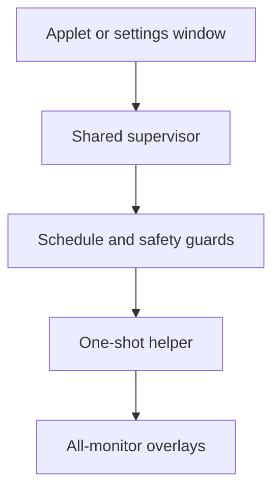

# Architecture and safety

[Quick start](../README.md) · [Reference](REFERENCE.md) · [Testing](TESTING.md)

Naal Focus separates persistent controls and scheduling from the short-lived process that captures keyboard focus. It is a native COSMIC/Wayland application, not a screen lock.

## Runtime components

| Component | Responsibility |
|---|---|
| `naal-focus` (`src/bin/applet.rs`, `src/applet.rs`) | COSMIC dock/panel icon and compact quick controls; Settings… / `--settings` opens or activates a dedicated grouped settings window. Built with the `applet` feature. |
| `Engine` (`src/engine.rs`) | Background control client or elected supervisor. Publishes shared status, applies requests, and owns at most one helper. |
| `Schedule` (`src/schedule.rs`) | Pure interval, snooze, and sequential quote-rotation policy. |
| `Guard` (`src/guard.rs`) | Checks session state through system D-Bus/logind and input idle state through Wayland. |
| `naal-focus-overlay` (`src/bin/overlay.rs`, `src/overlay.rs`) | Displays one reminder using one layer-shell surface per selected output. Has no recurring timer. |
| Renderer (`src/render.rs`) | Rasterizes text into shared-memory ARGB8888 buffers using a local font; caches the quote and repaints only the history/input strip during editing and dial motion. |
| Reflection state (`src/activity.rs`) | Pure UTF-8 editor, held/resumed countdown, fixed typing allowance, and accepted-text/correction state. |
| Activity history (`src/activity_log.rs`) | Private JSON-lines records, durable worker acknowledgments, idempotent retries, and atomic corrections. |
| Reflection recall (`src/recall.rs`) | Read-only worker loads today's records; pure consecutive grouping, keyboard dial selection, relative labels, and shared rolling animation. |
| Dashboard (`src/dashboard.rs`, `src/dashboard_page.html`) | Pure generation of the self-contained activity page, private writer, and detached browser open. |
| Settings (`src/config.rs`) | Validates preferences and quote syntax; loads and atomically saves JSON. |
| Process boundaries (`src/process.rs`) | Desktop compositor routing, runtime locks, boot-time clock, and helper cleanup. |

The supervisor sends one selected quote to the helper as bounded UTF-8 on stdin, rather than placing quote text in process arguments. The helper creates coordinated overlays with one shared reflection state. Only Enter-submitted text is persisted; raw keys are never recorded. Escape cancels a draft before ordinary dismissal; background clicks never cancel or dismiss; timeout, compositor closure, or output hotplug dismisses all surfaces.

## Reflection state and persistence

The field is initially ready for input, without holding the normal countdown. A text change or explicit history browsing freezes the remaining duration and starts the typing allowance once. Successful save or cancellation resumes exactly that duration. Accepted text replaces the field; clicking reopens it without pausing until the text changes. Corrections retain the record's ID and original timestamp. The typing deadline is never renewed; it applies while writing or browsing, not to the breathing countdown after a successful submission.

The helper owns the log worker; there is no new supervisor storage protocol. One in-flight submission prevents duplicate Enter events. The worker writes privately under `~/.naal-focus/` and acknowledges only after syncing. A stable advisory directory lock serializes append and correction operations even when the data-file inode changes. Corrections stream a validated history to a private temporary file, sync it, atomically rename it over the original, then sync the directory. Stable opaque IDs make acknowledgment retries idempotent; stale corrections fail without replacing newer data. History scanning bounds each record and does not load the whole file into memory.

Generation tokens keep late save results from erasing a newer draft. Canceling does not undo a write already explicitly submitted. The input/render loop only polls the worker and continues checking safety; a stalled filesystem must not strand keyboard focus.

At reminder opening, a separate worker scans history with the existing read-only owner/link/lock guards, filtering while scanning so only current-local-day records are retained. Future timestamps are excluded; valid records are stably sorted by timestamp and only consecutive identical texts are grouped. Missing history is empty; unreadable/busy history leaves input and safety checks active with an unavailable hint. The resulting snapshot is shared across all outputs. Browsing never modifies the editor; exiting restores its caret/selection and prior writing state. Enter recalls into the editor, not persistence; the next Enter uses the existing new-entry submission path. Corrections still apply only to this reminder's saved entry, never the recalled historical source.

Each output reuses two buffers with identical cached quote content. The reserved history/input/status strip is repainted and damaged for text changes, dial animation, caret blinking, or progress; quote pixels remain cached and outside that damage. The same monotonic animation time is used across outputs. Both buffers are initialized before normal typing begins; a compositor that stops releasing them cannot cause an unbounded allocation queue.

## Activity dashboard

The dashboard is generated, not served: **Dashboard…** rescans the history on every open through the lenient per-line loader, renders one self-contained HTML page, writes it privately beside the logs, and opens it through `xdg-open`. No server runs, and no history data is passed through process arguments or the network.

Generation is a pure module — parsed entries, one timestamp, and a time-zone conversion in; a single HTML string out — fully unit-testable without the GUI. The page embeds the aggregated data as JSON inside an inert `<script type="application/json">` element with `<`, `&`, and the JS line separators escaped into JSON escapes, so reflection text can never close the element or become executable markup. All rendering and interactivity happens client-side in the embedded script, built exclusively through DOM APIs that treat text as text.

The applet only polls the dashboard worker from its existing tick; blocking filesystem work never freezes the popup controls. Failures surface as the popup status line, never as a crash of the panel process. The output file is written privately (0600, owner-only) with the same symlink/hardlink refusals as `activity.jsonl`, replacing any earlier generation in place.

Statistics claim nothing the history does not contain: counts, times of day, day presence, and explicit `#tag` vocabulary derive from timestamps and text; durations and hours worked are never claimed because writing duration is never measured. Weeks run Monday through Sunday; the year map covers the current calendar year; days after today render as blank squares rather than zero counts. Malformed lines are skipped individually and reported in a quiet footnote; an unreadable history renders a restrained error page instead of a misleading empty one.

## One timer across multiple instances

COSMIC can launch an applet instance for each panel/dock output. The standalone settings window is another client; it must not introduce another reminder loop.

Each engine tries to own the session D-Bus name `io.github.rinaldo_rex.NaalFocus.Control` without queueing. The winner runs the supervisor and holds the `naal-focus-applet.lock` process lock in `XDG_RUNTIME_DIR`. Other instances relay requests and poll the owner's status; they do not start their own timer or guards.

The control object is `/io/github/rinaldo_rex/NaalFocus/Control`, with interface `io.github.rinaldo_rex.NaalFocus.Control1`. `Snapshot` returns JSON status and `Send` accepts a JSON request. Remote requests are size-bounded and validated; they cannot request supervisor shutdown.

- Closing a secondary instance only disconnects that client.
- Closing the owner drops its helper and releases ownership. Surviving clients compete to become the replacement.
- The replacement reloads saved settings, carries over the remaining snooze from its last status snapshot, and starts a fresh interval after safety checks.
- A brief process-lock overlap during replacement is retried instead of permanently disconnecting the controls.
- Closing every instance stops reminders. There is no separately installed daemon or service, and snoozes do not persist across a complete shutdown.

UI status is sampled rather than instantaneous: the owner processes its loop about every 100 ms, clients poll about every 250 ms, and controls refresh once per second. Settings drafts retain unsaved edits when shared settings change, including after a failed save or typing after a save request. The draft becomes clean when shared status matches the requested settings without an error.

## Quick controls and settings window

The popup contains only status, immediate reminder controls, and a Settings… entry point. The separate resizable desktop window groups configuration into Timing, Appearance, and Reflection, with a native quote editor and explicit Save.

`src/applet/launch.rs` launches the same binary with `--settings`, detached from the panel lifetime. It removes nested/privileged Wayland socket variables, resets panel scaling and stale launch-token overrides, and routes `WAYLAND_DISPLAY` to the validated desktop socket. COSMIC's applet-token subscription obtains a host-compositor activation token through the privileged channel; a panel-local token cannot authorize desktop focus. The window consumes the startup token after opening, while libcosmic handles tokens forwarded over its D-Bus activation interface for an existing window.

A separate `naal-focus-settings-window.lock` in `XDG_RUNTIME_DIR` serializes startup and the window lifetime, closing the race between simultaneous launches from different panels before D-Bus registration. A losing launcher retries activation for up to five seconds rather than creating a duplicate window. This window lock is independent of the shared-supervisor lock; closing settings does not shut down another applet's supervisor. If settings is the only remaining client, the existing all-instances-closed rule still applies.

## Desktop versus panel compositor

The applet UI runs through COSMIC's panel connection. That connection is not the desktop compositor: applets can inherit a nested `WAYLAND_SOCKET` which cannot create desktop-wide overlays.

`desktop_connection()` therefore connects directly to the socket named by `NAAL_FOCUS_WAYLAND_DISPLAY`, or otherwise `WAYLAND_DISPLAY`. Relative socket names resolve under `XDG_RUNTIME_DIR`; absolute socket paths are accepted. The installed desktop entry requests the host display through `X-HostWaylandDisplay=true`.

The supervisor validates this route before spawning the helper, removes `WAYLAND_SOCKET` and `X_PRIVILEGED_WAYLAND_SOCKET` from its environment, and passes the resolved desktop socket in `NAAL_FOCUS_WAYLAND_DISPLAY`. Both the idle guard and overlay use this explicit desktop connection. No display name is hardcoded.

## Safety rationale

Because reminders intentionally capture focus, uncertainty must suppress them rather than risk leaving an input-capturing overlay on an unsafe session.

| Policy | Mechanism and reason |
|---|---|
| Recurrence is opt-in | New settings start paused; installing or opening controls must not silently start interruptions. |
| Missing or stale safety data blocks reminders | Session and idle observations expire after three seconds. A disconnected or stalled guard must not be interpreted as an unlocked, active desktop. |
| Lock, idle, inactive sessions, and sleep block reminders | Session polling checks logind properties and COSMIC's runtime lock marker. Wayland `ext_idle_notifier_v1` version 2 observes input idle even when another application inhibits idle. No inhibitor is requested. |
| Unsafe sessions and scheduling gaps reset the interval | `CLOCK_BOOTTIME` includes suspended time. Gaps over three seconds and safety recovery start a full interval, discarding missed reminders instead of catching up immediately after wake or unlock. |
| Only one reminder is active | The supervisor owns at most one child, and the helper holds a separate overlay process lock. Manual requests cannot bypass safety or overlap an existing reminder. |
| Helper lifetime is bounded | The renderer handles its normal countdown, fixed typing allowance, and hard deadline. The parent independently checks safety and a duration-plus-typing-limit-plus-eight-second deadline, kills and reaps the child on cancellation, and sets Linux parent-death signaling. A stopped helper cannot defeat the parent's watchdog. |
| Failed helpers pause recurrence | Launch or unsuccessful helper-exit failures pause recurring reminders rather than repeatedly reopening a broken focus-capturing process. This is not a guarantee that the underlying failure has been repaired. |
| Invalid settings are preserved | Invalid or unsupported settings fall back to paused defaults. Only an explicit Save replaces the original file, so merely toggling recurrence cannot destroy it. |

The helper also checks safety independently, requires outputs to configure within three seconds, and caps render-buffer sizes. Saving settings or snoozing cancels a pending/visible reminder. **Show now** waits two seconds, including when recurrence is paused, but still requires a safe session.

These are safeguards, not a security boundary. Compositor shortcuts can still work, and restoring focus is COSMIC's responsibility. A manually launched helper has no parent supervisor; stopping it with SIGSTOP also stops its in-process timeout and watchdog. See the reference for rendering and session limitations.
