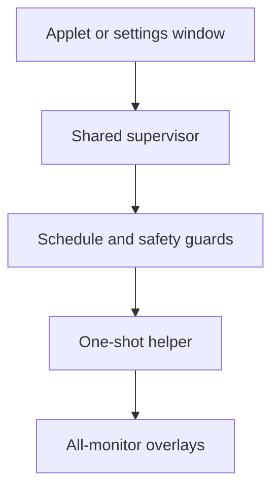

# Architecture and safety

[Quick start](../README.md) · [Reference](REFERENCE.md)

Naal Focus separates persistent controls and scheduling from the short-lived process that captures keyboard focus. It is a native COSMIC/Wayland application, not a screen lock.

## Runtime components

| Component | Responsibility |
|---|---|
| `naal-focus` (`src/bin/applet.rs`, `src/applet.rs`) | COSMIC dock/panel icon and controls; `--settings` opens the same controls in a standalone window. Built with the `applet` feature. |
| `Engine` (`src/engine.rs`) | Background control client or elected supervisor. Publishes shared status, applies requests, and owns at most one helper. |
| `Schedule` (`src/schedule.rs`) | Pure interval, snooze, and sequential quote-rotation policy. |
| `Guard` (`src/guard.rs`) | Checks session state through system D-Bus/logind and input idle state through Wayland. |
| `naal-focus-overlay` (`src/bin/overlay.rs`, `src/overlay.rs`) | Displays one reminder using one layer-shell surface per selected output. Has no recurring timer. |
| Renderer (`src/render.rs`) | Rasterizes text into shared-memory ARGB8888 buffers using a local font. |
| Settings (`src/config.rs`) | Validates preferences and quote syntax; loads and atomically saves JSON. |
| Process boundaries (`src/process.rs`) | Desktop compositor routing, runtime locks, boot-time clock, and helper cleanup. |

The supervisor sends one selected quote to the helper as bounded UTF-8 on stdin, rather than placing quote text in process arguments. The helper creates coordinated overlays and consumes ordinary keys without logging them. Escape, mouse-button release, timeout, compositor closure, or output hotplug dismisses every surface.

## One timer across multiple instances

COSMIC can launch an applet instance for each panel/dock output. The standalone settings window is another client; it must not introduce another reminder loop.

Each engine tries to own the session D-Bus name `io.github.rinaldo_rex.NaalFocus.Control` without queueing. The winner runs the supervisor and holds the `naal-focus-applet.lock` process lock in `XDG_RUNTIME_DIR`. Other instances relay requests and poll the owner's status; they do not start their own timer or guards.

The control object is `/io/github/rinaldo_rex/NaalFocus/Control`, with interface `io.github.rinaldo_rex.NaalFocus.Control1`. `Snapshot` returns JSON status and `Send` accepts a JSON request. Remote requests are size-bounded and validated; they cannot request supervisor shutdown.

- Closing a secondary instance only disconnects that client.
- Closing the owner drops its helper and releases ownership. Surviving clients compete to become the replacement.
- The replacement reloads saved settings, carries over the remaining snooze from its last status snapshot, and starts a fresh interval after safety checks.
- A brief process-lock overlap during replacement is retried instead of permanently disconnecting the controls.
- Closing every instance stops reminders. There is no separately installed daemon or service, and snoozes do not persist across a complete shutdown.

UI status is sampled rather than instantaneous: the owner processes its loop about every 100 ms, clients poll about every 250 ms, and controls refresh once per second. A popup's unsaved edits are retained when shared settings change.

## Desktop versus panel compositor

The applet UI runs through COSMIC's panel connection. That connection is not the desktop compositor: applets can inherit a nested `WAYLAND_SOCKET` which cannot create desktop-wide overlays.

`desktop_connection()` therefore connects directly to the socket named by `NAAL_FOCUS_WAYLAND_DISPLAY`, or otherwise `WAYLAND_DISPLAY`. Relative socket names resolve under `XDG_RUNTIME_DIR`; absolute socket paths are accepted. The installed desktop entry requests the host display through `X-HostWaylandDisplay=true`.

The supervisor validates this route before spawning the helper, removes `WAYLAND_SOCKET` and `X_PRIVILEGED_WAYLAND_SOCKET` from its environment, and passes the resolved desktop socket in `NAAL_FOCUS_WAYLAND_DISPLAY`. Both the idle guard and overlay use this explicit desktop connection. No display name is hardcoded.

## Safety rationale

Because reminders intentionally capture focus, uncertainty must suppress them rather than risk leaving an input-capturing overlay on an unsafe session.

| Policy | Mechanism and reason |
|---|---|
| Recurrence is opt-in | New settings start paused; installing or opening controls must not silently start interruptions. |
| Missing or stale safety data blocks reminders | Session and idle observations expire after three seconds. A disconnected or stalled guard must not be interpreted as an unlocked, active desktop. |
| Lock, idle, inactive sessions, and sleep block reminders | Session polling checks logind properties and COSMIC's runtime lock marker. Wayland `ext_idle_notifier_v1` version 2 observes input idle even when another application inhibits idle. No inhibitor is requested. |
| Unsafe sessions and scheduling gaps reset the interval | `CLOCK_BOOTTIME` includes suspended time. Gaps over three seconds and safety recovery start a full interval, discarding missed reminders instead of catching up immediately after wake or unlock. |
| Only one reminder is active | The supervisor owns at most one child, and the helper holds a separate overlay process lock. Manual requests cannot bypass safety or overlap an existing reminder. |
| Helper lifetime is bounded | The renderer handles its normal timeout and a hard deadline. The parent independently checks safety and a duration-plus-eight-second deadline, kills and reaps the child on cancellation, and sets Linux parent-death signaling. A stopped helper cannot defeat the parent's watchdog. |
| Failed helpers pause recurrence | Launch or unsuccessful helper-exit failures pause recurring reminders rather than repeatedly reopening a broken focus-capturing process. This is not a guarantee that the underlying failure has been repaired. |
| Invalid settings are preserved | Invalid or unsupported settings fall back to paused defaults. Only an explicit Save replaces the original file, so merely toggling recurrence cannot destroy it. |

The helper also checks safety independently, requires outputs to configure within three seconds, and caps render-buffer sizes. Saving settings or snoozing cancels a pending/visible reminder. **Show now** waits two seconds, including when recurrence is paused, but still requires a safe session.

These are safeguards, not a security boundary. Compositor shortcuts can still work, and restoring focus is COSMIC's responsibility. A manually launched helper has no parent supervisor; stopping it with SIGSTOP also stops its in-process timeout and watchdog. See the reference for rendering and session limitations.
